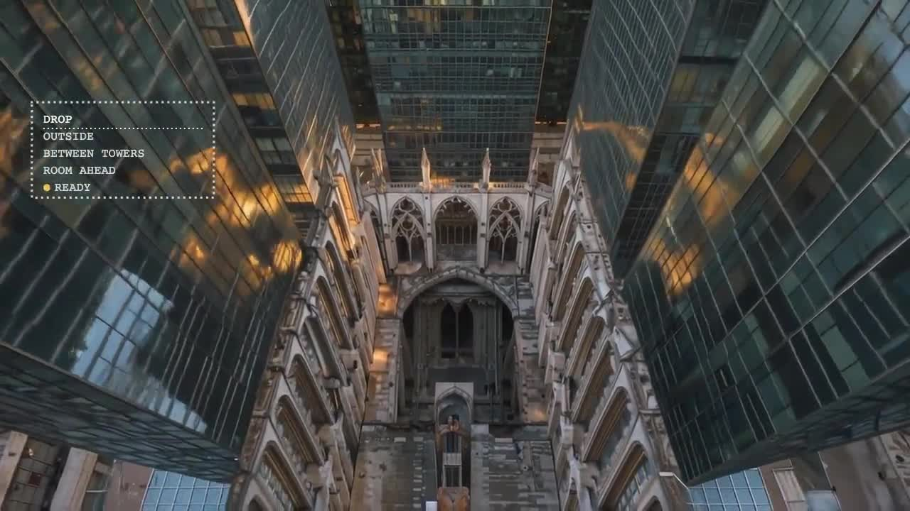

# Genobi

**Build the scene. Shape the sound. Make the cut.**

Genobi brings several tools I’ve built into one open-source video studio,
with new tools connecting scene building, sound, generation and editing.
You and your agent work on the same creative project: the agent makes a first
pass, you adjust timing, move or trim clips, add notes or give directions by
voice, and those changes guide the next version.

**Open-source first.** Run your own studio, choose an open-weight local workflow
or connect cloud models, and bring the agent harness that fits your project.

[Try Genobi](https://genobi.pages.dev) ·
[Watch the teaser](https://genobi.pages.dev/watch/genobi-teaser) ·
[Open it in Editor](https://genobi.pages.dev/director?example=genobi-teaser&workspace=editor) ·
[Get started](docs/getting-started.md) ·
[Documentation](docs/README.md)

https://github.com/user-attachments/assets/b2665e97-2836-4e02-8b38-4694a5c6b6c7

## Try it in a few minutes

1. **Open the [studio](https://genobi.pages.dev).** Explore the Gallery without a key.
2. **Start with a mix template.** Open an editable example, change a title or
   trim a clip in Editor, and preview your version.
3. **Export your work.** Save an MP4 to share and an editable project ZIP to
   continue later. Browser drafts need saving before you close or reload.

Editing existing media does not need generation credits. To generate new
media, connect your own Comfy or BFL key and check the selected model's cost.
Agents need your approval before paid operations. See [setup and keys](docs/getting-started.md).

## One scene guides picture and sound

[](docs/media/acoustic-space-demo.mp4?raw=true)

**[Watch with sound · 30 seconds](docs/media/acoustic-space-demo.mp4?raw=true).**
As the camera falls through different spaces, the reverb changes with the room.
Three.js scenes inside ComfyUI guide the visuals and the scene-derived CPU reverb.

**Acoustic Space connects the room you build to the sound you hear.** Build a
Three.js set yourself or with an agent in World Builder, also available inside
ComfyUI through Genobi’s custom nodes. Capture layouts and camera moves to guide
LTX-2.5 with Layout-to-Render IC-LoRA, with Klein for look development and
first-frame references.

The same scene supplies geometry and materials to the Acoustics and Reverb
nodes. They estimate the room response and apply CPU reverb to music or voice,
so an edit can move from a small room to a club or cathedral with a different
sound for each space. This is an approximate room model, with inspectable inputs
and reusable workflows. **AKUSPACE**, my trained LTX LoRA, is a separate
experimental route for room-conditioned generated audio/video.

[3D/acoustics workflow examples and original prompts](examples/ltx-world/README.md)
· [Open the editable example](https://genobi.pages.dev/director?example=adaptive-reverb&workspace=editor)

[World Builder](docs/world-builder.md) ·
[Acoustics and reverb](docs/world-builder-acoustics.md) ·
[ComfyUI nodes and examples](custom_nodes/director_world_builder/README.md)

### Editable scene motion

World Builder's **Library → Presets** gallery includes fifteen motion and story presets: city-to-loft camera journeys, spacecraft/mecha, masks, palms, finer fruits and enclosed architecture at 64/128/256 blocks. The global **Loop** panel saves complete shape/camera views as A–D: load an asset, frame it directly in Shot, save A, load another and save B. Play returns to A; Save loop captures the result. Camera sits beside Expand, music stays in the sidebar, and assets sit below the dark-grid view. Choose direct/scatter/twist/assembly paths, independent camera/object rotation, measured audio links and a frame-grid duration through 30 seconds. The optional **Build a morph** composer also tick-selects two to four individual authored forms. See [the loop workflow](docs/world-builder-loops.md) and [scene motion](docs/world-builder-motion.md).

**Story · Endless descent** connects a street, full-scale cathedral, club and DJ studio in one continuous fall. **Story · Bass avenue** makes towers and taxis respond to separate frequency bands. The global **Scene size** fader resizes the surroundings while the mannequin stays 1.8 m tall; explicit room dimensions drive the browser CPU sound preview. See [human-scale stories](docs/world-builder-stories.md) and [dynamic acoustic zones](docs/world-builder-acoustic-zones.md).

The same gallery and **Editor → Add track → Animations & Effects** expose Poster window, Cinematic scan/HUD, Kinetic title and Liquid mirror. Preview and save variants, then insert ordinary editable layers in one Undo action. The [effects catalogue](docs/effects-catalogue.md) documents controls, trusted-source validation and UI/API/CLI/MCP access.

The apartment and cathedral studies also render [changing room sound](docs/world-builder-dynamic-sound.md) on the browser CPU. Choose an independent dry source, follow the evaluated room timeline, preview in sync with the scene, and export a WAV with its frozen recipe and sound receipt.

## Create, edit and revise

- **Edit an existing Klein image.** Drop your source straight onto Image layout, add bounding boxes and describe changes. Resize the preview from its corner for detailed work.
- **Direct across models.** Camera controls adapt to FLUX video, LTX and
  MiniMax H3 using their documented prompting language. Klein has image framing,
  layouts and first-frame references. [Camera wording and sources](docs/camera-wording.md).
- **Make music and shape sound.** Generate with MiniMax Music 3 in the local
  studio, bring your own tracks, and use room reverb in your ComfyUI workflows.
- **Edit and revise with an agent.** Director and Editor share an editable
  timeline. Move, trim and layer clips, add frame notes, then hand the changes
  back. Dual Swords compares footage and extracts exact frames.
- **Bring your own harness.** Connect Hermes, Claude Code or Codex through
  MCP, CLI and skills. The local studio also supports voice directions using
  Qwen3-ASR and a Development workspace for extending the app. Voice defaults
  to the agent, remembers your destination and offers explicit prompt dictation.
- **Build your Taste layer.** Celebrate creative work with links and credit to
  its creators, then add your own favourite references. Save personal selections
  in the local studio or extend the catalogue in your fork. Project memory keeps
  decisions; licence preferences help agents choose suitable models and libraries.

[Explore Taste and credits](https://genobi.pages.dev/taste) ·
[Detailed studio controls](docs/studio-guide.md)

## Start from a template

The submission teaser was assembled in Genobi using a range of models and is
itself an editable example. Those production choices do not lock your next
project to the same models. The Gallery includes music-led creature edits, Bloom and the
adaptive-reverb demonstration. Public watch/embed pages share the result;
editable templates and exported project bundles let someone else remix it.
Private projects are not automatically public.

[Browse the Gallery](https://genobi.pages.dev) ·
[Templates and sharing](docs/template-gallery.md) ·
[Versioned example projects](docs/director-bundle/showcase/README.md)

## Choose where to run

Comfy Cloud and the BFL API are the primary hosted generation choices.
Run the studio locally to add local agent, voice and project integrations;
choose local ComfyUI when you want supported workflows on your own hardware.

**Check Comfy Cloud workflows** in Settings reads your account's node and model
availability before a render. Agents can use the same [read-only check](docs/comfy-readiness.md).

| Setup                        | What you need                                                         | Good for                                                        |
| ---------------------------- | --------------------------------------------------------------------- | --------------------------------------------------------------- |
| Hosted studio                | A browser; your provider key for generation                           | Trying examples, browser editing and supported cloud generation |
| Local studio + cloud models  | Node.js 22+, provider keys and credits                                | Local agent/voice tools without a local generation GPU          |
| Local studio + local ComfyUI | Node.js 22+, ComfyUI, required nodes and weights on suitable hardware | Running supported open-weight workflows yourself                |

Local voice, Arena and Music 3 require the local studio. The hosted app can
pair an existing local agent runner. Model availability varies by route;
custom ComfyUI graphs and the studio's one-click integrations have different
setup and verification requirements. See [getting started](docs/getting-started.md)
and [current limitations](docs/troubleshooting.md).

Editable templates open **Generate my version** in Director or Editor: reuse
assets, upload replacements, apply undoable swaps, or ask your linked agent to
prepare new media. Paid generation waits for approval in the bubble. See
[the version guide](docs/director-generate.md). Camera on the hosted or local studio can register
[a Comfy deployment](docs/comfy-deploy.md#use-it-from-camera) for Layout-to-video
and AKUSPACE. These require a deployment in your own Comfy workspace and an authorised key; that workspace pays for GPU usage. Other cloud generations only need their supported provider key.

### Run locally

Install [Node.js 22 or newer](https://nodejs.org), then:

```sh
git clone https://github.com/koshimazaki/genobi.git
cd genobi
npm ci
npm run dev
```

Open **http://127.0.0.1:4317** and choose **Explore first** to try an edit.
No Cloudflare account or model download is needed for the studio itself.
FFmpeg/ffprobe, local voice and ComfyUI are optional additions for their
respective tools. [Follow the setup guide](docs/getting-started.md).

## Models and workflows

| Role                                          | Model or tool                                                    |
| --------------------------------------------- | ---------------------------------------------------------------- |
| Images, look development and first frames     | FLUX 3 Image Klein                                               |
| Video and 3D layout guidance                  | LTX-2.5 and Layout-to-Render IC-LoRA                             |
| Creature morphs and character transformations | MiniMax H3                                                       |
| Sound shaped by a scene                       | CPU Acoustics/Reverb nodes; separate AKUSPACE LTX LoRA workflows |
| Music                                         | MiniMax Music 3                                                  |
| Upscaling                                     | SeedVR2 or FLUX Video Upscale                                    |

These are workflow choices, not a claim that every route runs on every host.
Open-weight workflows are available alongside API models such as FLUX 3 video.
Comfy Router handles supported model API calls; the official Comfy SDK handles
workflow jobs. Example footage may use different models from a template's
next generation step; consult its provenance notes.

The worked LTX / World Builder graphs now have a shared
[deployment recipe](docs/comfy-deploy.md) and
[three key workflow paths](workflows/README.md#demo-workflows). The recipe
passes offline validation; a live Comfy Developer Platform deployment and
paid endpoint runs still need separate verification.

[Workflow files and requirements](workflows/README.md) ·
[World Builder ComfyUI nodes](custom_nodes/director_world_builder/README.md) ·
[Capability and verification map](docs/capabilities.md)

## Open source, credits and contributing

Original Genobi code is **MIT**. Model weights, music, example assets and
third-party components retain their own licences; open weights do not mean
unrestricted commercial use. The licence layer guides choices and records
provenance—it does not grant rights. See [LICENCES.md](LICENCES.md) and
[creator credits](docs/credits/README.md).

Fork the repository, run your own copy and contribute improvements. To work
on the code, start with [AGENTS.md](AGENTS.md), the
[code read-through](docs/read-through.md) and the [review checklist](docs/review-checklist.md).
For your own hosted instance, follow [Cloudflare deployment](docs/cloudflare.md).

[Credits and lineage](docs/credits.md) document the shared tools, Genobi’s new
work and the people and projects that make the studio possible.
Not affiliated with Comfy, Lightricks, Black Forest Labs or MiniMax.
