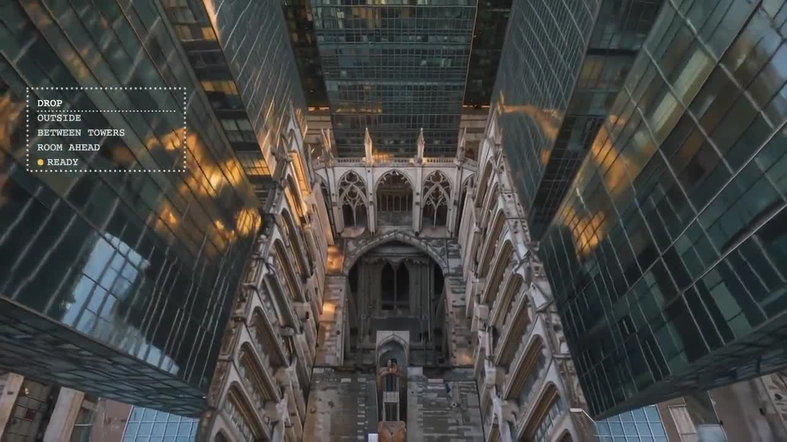

# Genobi

**Build the scene. Shape the sound. Make the cut.**

Genobi is a voice-first, harness-first video studio. Talk to it, or give
instructions to your own agent; the screen is mainly for inspecting what comes
back and viewing your assets. It brings several tools I’ve built into one
open-source studio, with new tools connecting scene building, sound, generation
and editing, all in one project you and your agent work on together.

**Open-source first.** Run your own studio, choose an open-weight local workflow
or connect cloud models, and bring the agent harness that fits your project.

[Try Genobi](https://genobi.pages.dev) ·
[Watch the teaser](https://genobi.pages.dev/watch/genobi-teaser) ·
[Open it in Editor](https://genobi.pages.dev/director?example=genobi-teaser&workspace=editor) ·
[Get started](docs/getting-started.md) ·
[Documentation](docs/README.md)

https://github.com/user-attachments/assets/b2665e97-2836-4e02-8b38-4694a5c6b6c7

## How Genobi answers the challenge

My entry to Comfy's [Open Source Higgsfield](https://comfy.org/open-source-higgsfield)
challenge; the full record is the [submission dossier](docs/submission.md).

### Built with LTX (Most Innovative, LTX VFX bonus)

A World Builder scene moves to the music, one still sets the look, and
LTX-2.5 with the Layout-to-Render IC-LoRA paints the video with the track in
it ([featured workflow](audio-reactive/README.md)). The same geometry feeds
acoustic measurement and CPU room reverb, so each room sounds its size: in
Acoustic Spaces v2 the decay runs from 0.2 s in a booth to over 5 s between
towers. AKUSPACE, our LoRA on LTX-2.5, is a separate route for room-conditioned sound
([adaptive reverb evidence](docs/adaptive-reverb-proof.md)).

https://github.com/user-attachments/assets/8721af01-1a54-44dc-8d7d-c96eade6aa13

<p align="center"><em>Audio Reactive Acoustic Spaces v2. Five World Builder rooms rendered with LTX-2.5 Layout-to-Render; the reverb follows each room's measured size.</em><br><a href="https://genobi.pages.dev/watch/audio-reactive-drop">Watch page</a> · <a href="docs/media/acoustic-spaces-v2-readme.mp4?raw=true">MP4</a></p>

### Built with FLUX

FLUX 3 Image Klein makes the stills, first frames and box edits most
workflows start from, through BFL's API or as a Comfy workflow. The camera
panel, with a Three.js diagram of each shot, gives camera control in the UI
that follows each model lab's own prompting guidance for FLUX 3, LTX-2.5 and
MiniMax H3 ([camera wording](docs/camera-wording.md),
[H3](docs/minimax-h3-camera.md)). The diagram doubles as a teaching layer,
showing what each camera term does before you spend a credit. To my
knowledge no platform offers native camera control across all three.
[Dual Swords](docs/dual-editor.md) compares two clips and exports exact frames
to Assets for the next generation.

### Made to be shared (Most Viral)

Every Gallery card has a public watch page and an embed page, such as
[/watch/fruits-swap](https://genobi.pages.dev/watch/fruits-swap). Copy the
link or the iframe; each page puts the MP4 and a player in its link preview
(`og:video`, `twitter:player`), so the clip plays inside Discord and X.
**Make your own** opens the cut as an editable project for your own media
([sharing](docs/template-gallery.md#sharing)). Dance with Fruits shows the
pattern: a technical LTX workflow turned into a 33-second loop anyone can
watch, share and remix.

https://github.com/user-attachments/assets/10b0805f-91a8-44df-9c8b-98ec109b9f31

<p align="center"><em>Dance with Fruits. Fruits as architecture, morphed in Three.js and used as model guidance: four LTX-2.5 Layout-to-Render characters on one dance guide.</em><br><a href="https://genobi.pages.dev/watch/fruits-swap">Watch page</a> · <a href="docs/media/dance-with-fruits-readme.mp4?raw=true">MP4</a></p>

### Open Weights Only

The critical path is open source end to end; API and paid routes are a thin
optional layer. Open-weight steps: LTX-2.5 and its IC-LoRAs, AKUSPACE, Klein
and SeedVR2 for upscaling, run on your own ComfyUI, on Comfy Cloud or on the
Comfy deployment `genobi-ltx-world-v2`; most of the hosted path runs on Comfy
Cloud and Comfy Deploy. The agent is open too: Hermes Agent (MIT), which
Start Genobi sets up, runs on open-weight models such as DeepSeek V4.1 Flash
or Qwen3-VL ([agent setup](docs/agent-setup.md)), and the built-in voice mode
transcribes on your machine with the open Qwen3-ASR, which you can adapt in
your own setup ([voice setup](docs/voice-setup.md)). The open path runs end
to end: agent, voice, generation and upscaling.
Optional closed routes: FLUX 3 video, FLUX Video Upscale, Klein through BFL's
API, MiniMax H3 and Music 3, and LTX Fast/Pro through Comfy Router. Inputs
are format-agnostic: swap a template's track or clips for your own or
open-weight media with **Make my version**. State your project's licence
needs at setup and the agent picks models and libraries that fit
([licence-aware direction](docs/licence-strategy.md#the-setup-question)); to
my knowledge no other platform has a licence layer that selects models this way.
Terms per model: [LICENCES.md](LICENCES.md) and [credits](docs/credits.md).

### One agentic loop (Best Overall)

The agent and you edit one Director/Editor timeline; it reads back your
changes and quotes every paid step first. A **licence layer** records each
model's terms, a **Taste layer** keeps credited references as project memory,
the deck shows what the agent is doing and the hosted studio keeps
[count-only statistics](observability/README.md). Templates sit on top as
skills an agent can rerun. Dance with Fruits came from spoken rounds of "take
this one, make a new one, add this" ([log](audio-reactive/edit/LOG.md)); every
slot keeps the still and prompt that made it ([Fruits](docs/fruits-swap.md),
[Acoustic Spaces v2](docs/audio-reactive-drop.md)).

### Evidence map, for reviewers and their agents

| Claim                                                                                                                                   | Where to look                                                                                                                                                                                                                                              |
| --------------------------------------------------------------------------------------------------------------------------------------- | ---------------------------------------------------------------------------------------------------------------------------------------------------------------------------------------------------------------------------------------------------------- |
| What Genobi is and how the entry was built                                                                                              | [docs/submission.md](docs/submission.md), [docs/README.md](docs/README.md)                                                                                                                                                                                 |
| LTX: audio-reactive Layout-to-Render, acoustic measurement, AKUSPACE, adaptive reverb                                                   | [audio-reactive/README.md](audio-reactive/README.md), [workflows/](workflows/), [docs/audio-reactive-drop.md](docs/audio-reactive-drop.md), [docs/adaptive-reverb-proof.md](docs/adaptive-reverb-proof.md)                                                 |
| FLUX: Klein stills, camera control that follows each lab's guidance, Dual Swords frame export                                           | [docs/camera-wording.md](docs/camera-wording.md), [docs/minimax-h3-camera.md](docs/minimax-h3-camera.md), [docs/dual-editor.md](docs/dual-editor.md)                                                                                                       |
| Shareable: watch and embed pages, Make your own, Make my version                                                                        | [docs/template-gallery.md#sharing](docs/template-gallery.md#sharing), [genobi.pages.dev/watch/fruits-swap](https://genobi.pages.dev/watch/fruits-swap)                                                                                                     |
| Open weights: the open path per step, from agent and voice to generation and upscaling, the optional closed routes, every model's terms | [LICENCES.md](LICENCES.md), [docs/capabilities.md](docs/capabilities.md), [docs/agent-setup.md](docs/agent-setup.md), [docs/voice-setup.md](docs/voice-setup.md), [docs/credits.md](docs/credits.md), [docs/licence-strategy.md](docs/licence-strategy.md) |
| Agentic loop: plugin with MCP, CLI and skills, Director and Editor, observability                                                       | [plugins/genobi/README.md](plugins/genobi/README.md), [audio-reactive/edit/LOG.md](audio-reactive/edit/LOG.md), [observability/README.md](observability/README.md)                                                                                         |
| Run it: local studio, Comfy Cloud, the Comfy deployment                                                                                 | [docs/getting-started.md](docs/getting-started.md), [comfy-build/](comfy-build/)                                                                                                                                                                           |

## Start here

Run the [local studio](#run-locally), then pick a way in:

**Talk to it.** Press the mic and say what you want; your agent gets the text.
Qwen3-ASR transcribes on your machine after a one-time 1.9 GB model download
(Python 3.11 and ffmpeg needed). Local studio only. [Voice setup](docs/voice-setup.md).

**Bring your agent.** Hermes (open source), Claude Code or Codex drive the
studio through the [Genobi plugin](plugins/genobi/README.md): MCP, CLI and
skills, with every gallery card shipped as a skill with a plain-words brief. Start Genobi sets up Hermes; for Claude Code, `claude --plugin-dir plugins/genobi`.

No manual needed: drop your images, video and audio into **Assets** and tell the
agent what they are and what you want. Camera shows what came back, Assets holds
what you dropped in, and the deck shows what the agent is doing. Anything paid
waits for your approval in the studio.

## Try it in a few minutes

1. **Open the [studio](https://genobi.pages.dev).** Explore the Gallery without a key.
2. **Start with a mix template.** Open an editable example, change a title or
   trim a clip in Editor, and preview your version.
3. **Export your work.** Save an MP4 to share and an editable project ZIP to
   continue later. Browser drafts need saving before you close or reload.

Editing existing media does not need generation credits. To generate new
media, connect your own Comfy or BFL key and check the selected model's cost.
Agents need your approval before paid operations. See [setup and keys](docs/getting-started.md).

## One scene guides picture and sound

Acoustic Spaces v2 and Dance with Fruits, the two clips [above](#how-genobi-answers-the-challenge), both come from this mechanism.

<!-- Three.js fruit-morph clip: drop the mp4 here as the example for the morph. -->

[](docs/media/acoustic-space-demo.mp4?raw=true)

**[Watch with sound · 30 seconds](docs/media/acoustic-space-demo.mp4?raw=true).**
As the camera falls through different spaces, the reverb changes with the room.
Three.js scenes inside ComfyUI guide the visuals and the scene-derived CPU reverb.

**Acoustic Space connects the room you build to the sound you hear.** Build a
Three.js set yourself or with an agent in World Builder, also available inside
ComfyUI through Genobi’s custom nodes. Capture layouts and camera moves to guide
LTX-2.5 with Layout-to-Render IC-LoRA, with Klein for look development and
first-frame references.

The same scene supplies geometry and materials to the Acoustics and Reverb
nodes. They estimate the room response and apply CPU reverb to music or voice,
so an edit can move from a small room to a club or cathedral with a different
sound for each space. This is an approximate room model, with inspectable inputs
and reusable workflows. **AKUSPACE**, my trained LTX LoRA, is a separate
experimental route for room-conditioned generated audio/video.

[3D/acoustics workflow examples and original prompts](examples/ltx-world/README.md)
· [Open the editable example](https://genobi.pages.dev/director?example=adaptive-reverb&workspace=editor)

[World Builder](docs/world-builder.md) ·
[Acoustics and reverb](docs/world-builder-acoustics.md) ·
[ComfyUI nodes and examples](custom_nodes/director_world_builder/README.md)

### Editable scene motion

World Builder's **Library → Presets** gallery includes fifteen motion and story presets: city-to-loft camera journeys, spacecraft/mecha, masks, palms, finer fruits and enclosed architecture at 64/128/256 blocks. The global **Loop** panel saves complete shape/camera views as A–D: load an asset, frame it directly in Shot, save A, load another and save B. Play returns to A; Save loop captures the result. Camera sits beside Expand, music stays in the sidebar, and assets sit below the dark-grid view. Choose direct/scatter/twist/assembly paths, independent camera/object rotation, measured audio links and a frame-grid duration through 30 seconds. The optional **Build a morph** composer also tick-selects two to four individual authored forms. See [the loop workflow](docs/world-builder-loops.md) and [scene motion](docs/world-builder-motion.md).

**Story · Endless descent** connects a street, full-scale cathedral, club and DJ studio in one continuous fall. **Story · Bass avenue** makes towers and taxis respond to separate frequency bands. The global **Scene size** fader resizes the surroundings while the mannequin stays 1.8 m tall; explicit room dimensions drive the browser CPU sound preview. See [human-scale stories](docs/world-builder-stories.md) and [dynamic acoustic zones](docs/world-builder-acoustic-zones.md).

The same gallery and **Editor → Add track → Animations & Effects** expose Poster window, Cinematic scan/HUD, Kinetic title and Liquid mirror. Preview and save variants, then insert ordinary editable layers in one Undo action. The [effects catalogue](docs/effects-catalogue.md) documents controls, trusted-source validation and UI/API/CLI/MCP access.

The apartment and cathedral studies also render [changing room sound](docs/world-builder-dynamic-sound.md) on the browser CPU. Choose an independent dry source, follow the evaluated room timeline, preview in sync with the scene, and export a WAV with its frozen recipe and sound receipt.

## Create, edit and revise

- **Make audio-reactive video, repeatably.** A World Builder scene moves to a track window, one still sets the look and LTX-2.5 Layout-to-Render paints it: three videos and thirteen presets with track, subject and space swaps an agent can rerun. [The featured workflow](audio-reactive/README.md).
- **Edit an existing Klein image.** Drop your source straight onto Image layout, add bounding boxes and describe changes. Resize the preview from its corner for detailed work.
- **Direct across models.** Camera controls adapt to FLUX video, LTX and
  MiniMax H3 using their documented prompting language. Klein has image framing,
  layouts and first-frame references. [Camera wording and sources](docs/camera-wording.md).
- **Make music and shape sound.** Generate with MiniMax Music 3 in the local
  studio, bring your own tracks, and use room reverb in your ComfyUI workflows.
- **Edit and revise with an agent.** Director and Editor share an editable
  timeline. Move, trim and layer clips, add frame notes, then hand the changes
  back. Dual Swords compares footage and extracts exact frames.
- **Bring your own harness.** Connect Hermes, Claude Code or Codex through
  MCP, CLI and skills. The local studio also supports voice directions using
  Qwen3-ASR and a Development workspace for extending the app. Voice defaults
  to the agent, remembers your destination and offers explicit prompt dictation.
- **Build your Taste layer.** Celebrate creative work with links and credit to
  its creators, then add your own favourite references. Save personal selections
  in the local studio or extend the catalogue in your fork. Project memory keeps
  decisions; licence preferences help agents choose suitable models and libraries.

[Explore Taste and credits](https://genobi.pages.dev/taste) ·
[Detailed studio controls](docs/studio-guide.md)

## Start from a template

The submission teaser was assembled in Genobi using a range of models and is
itself an editable example. Those production choices do not lock your next
project to the same models. The Gallery includes music-led creature edits, Bloom and the
adaptive-reverb demonstration, with
[Audio Reactive Acoustic Spaces v2](docs/audio-reactive-drop.md) and
[Dance with Fruits](docs/fruits-swap.md) as editable mix templates. [Public watch/embed pages](#made-to-be-shared-most-viral) share the result;
editable templates and exported project bundles let someone else remix it.
Private projects are not automatically public.

[Browse the Gallery](https://genobi.pages.dev) ·
[Templates and sharing](docs/template-gallery.md) ·
[Versioned example projects](docs/director-bundle/showcase/README.md)

## Choose where to run

Comfy Cloud and the BFL API are the primary hosted generation choices.
Run the studio locally to add local agent, voice and project integrations;
choose local ComfyUI when you want supported workflows on your own hardware.

**Check Comfy Cloud workflows** in Settings reads your account's node and model
availability before a render. Agents can use the same [read-only check](docs/comfy-readiness.md).

| Setup                        | What you need                                                         | Good for                                                        |
| ---------------------------- | --------------------------------------------------------------------- | --------------------------------------------------------------- |
| Hosted studio                | A browser; your provider key for generation                           | Trying examples, browser editing and supported cloud generation |
| Local studio + cloud models  | Node.js 22+, provider keys and credits                                | Local agent/voice tools without a local generation GPU          |
| Local studio + local ComfyUI | Node.js 22+, ComfyUI, required nodes and weights on suitable hardware | Running supported open-weight workflows yourself                |

Local voice, Arena and Music 3 require the local studio. The hosted app can
pair an existing local agent runner. Model availability varies by route;
custom ComfyUI graphs and the studio's one-click integrations have different
setup and verification requirements. See [getting started](docs/getting-started.md)
and [current limitations](docs/troubleshooting.md).

Editable templates open **Make my version** in Director or Editor: keep the
cut, effects and soundtrack, and swap your own media into its slots with Undo.
Nothing there generates; new media is made in Camera and appears in Assets →
Generated. [**Make it with the agent**](docs/director-generate.md#make-it-with-the-agent)
takes an optional reference drop and one sentence, typed or spoken, saying what
it replaces, then starts your agent on the template's skill with every paid
step quoted first; every slot shows the still and prompt that made it. See [the version guide](docs/director-generate.md). Camera on the hosted or local studio can register
[a Comfy deployment](docs/comfy-deploy.md#use-it-from-camera) for Layout-to-video
and AKUSPACE. These require a deployment in your own Comfy workspace and an authorised key; that workspace pays for GPU usage. Other cloud generations only need their supported provider key.

### Run locally

Install [Node.js 22 or newer](https://nodejs.org), then:

```sh
git clone https://github.com/koshimazaki/genobi.git
cd genobi
npm ci
npm run dev
```

Open **http://127.0.0.1:4317** and choose **Explore first** to try an edit.
No Cloudflare account or model download is needed for the studio itself.
FFmpeg/ffprobe, local voice and ComfyUI are optional additions for their
respective tools. [Follow the setup guide](docs/getting-started.md).

## Models and workflows

| Role                                          | Model or tool                                                    |
| --------------------------------------------- | ---------------------------------------------------------------- |
| Images, look development and first frames     | FLUX 3 Image Klein                                               |
| Video and 3D layout guidance                  | LTX-2.5 and Layout-to-Render IC-LoRA                             |
| Creature morphs and character transformations | MiniMax H3                                                       |
| Sound shaped by a scene                       | CPU Acoustics/Reverb nodes; separate AKUSPACE LTX LoRA workflows |
| Music                                         | MiniMax Music 3                                                  |
| Upscaling                                     | SeedVR2 or FLUX Video Upscale                                    |

These are workflow choices, not a claim that every route runs on every host.
Open-weight workflows are available alongside API models such as FLUX 3 video.
Comfy Router handles supported model API calls; the official Comfy SDK handles
workflow jobs. Example footage may use different models from a template's
next generation step; consult its provenance notes.

The worked LTX / World Builder graphs now have a shared
[deployment recipe](docs/comfy-deploy.md) and
[three key workflow paths](workflows/README.md#demo-workflows). The recipe
passes offline validation. The hosted deployment `genobi-ltx-world-v2` is now
the first render route for the audio-reactive templates and scales to zero
between jobs; its evidence is in
[Deployment v2, reported 4 November 2026](docs/comfy-deploy.md#deployment-v2-reported-4-november-2026).

[Workflow files and requirements](workflows/README.md) ·
[World Builder ComfyUI nodes](custom_nodes/director_world_builder/README.md) ·
[Capability and verification map](docs/capabilities.md)

## Open source, credits and contributing

Original Genobi code is **MIT**. Model weights, music, example assets and
third-party components retain their own licences; open weights do not mean
unrestricted commercial use. The licence layer guides choices and records
provenance—it does not grant rights. See [LICENCES.md](LICENCES.md) and
[creator credits](docs/credits/README.md).

Fork the repository, run your own copy and contribute improvements. To work
on the code, start with [AGENTS.md](AGENTS.md), the
[code read-through](docs/read-through.md) and the [review checklist](docs/review-checklist.md).
For your own hosted instance, follow [Cloudflare deployment](docs/cloudflare.md).

[Credits and lineage](docs/credits.md) document the shared tools, Genobi’s new
work and the people and projects that make the studio possible.
Not affiliated with Comfy, Lightricks, Black Forest Labs or MiniMax.
