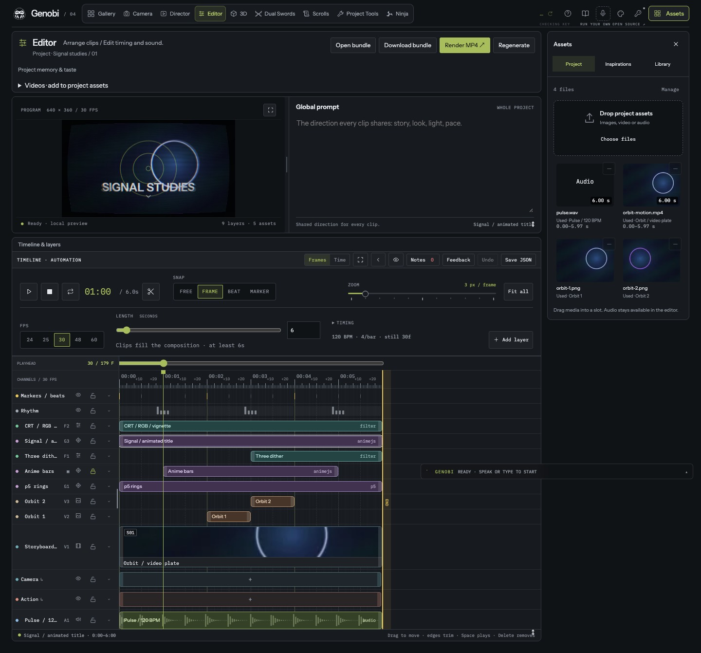

# Editor timeline

The Editor keeps its editing engine, frame ruler, integer-frame storage,
transport clock, render and export. The timeline design
was ported as presentation over that engine. Prompts and directions use the commands from the prompt
contract (`shared/director/directions.ts`, `prompt-commands.ts`).

[Camera picker and docked inspector](assets/editor-timeline/camera-picker.jpg) ·
[channels at dot width](assets/editor-timeline/channels-dots.jpg) ·
[Cyberpunk theme](assets/editor-timeline/desktop-cyberpunk.jpg) ·
[390 px phone](assets/editor-timeline/phone-390.jpg)

## What a person sees

- **Program and Global prompt** sit side by side, divided by a handle
  (`ProgramRow.tsx`, `ProjectDirection.tsx`), and stack below 850 px. The
  global prompt runs `set-global-prompt`; editing it never quotes or submits.
  Double-click Program, or press Enlarge preview, for a lightbox that mirrors
  the live canvas (`ProgramLightbox.tsx`). The panel's ↕ (drag, or Up/Down;
  Home restores) sets the row's height: Program grows to fit the column's
  width and the row's height, keeping the composition's aspect, and the
  prompt fills its column (`program-fit.css`). Only the display grows; the
  canvas stays the composition's own resolution, so a larger view shows
  those pixels, not more of them. Until the first frame is drawn, Program
  says "Rendering the first frame…". Checked by
  `scripts/check-editor-program-height.mjs`; see the row
  [before](assets/editor-timeline/program-drag-before.jpg) and
  [after](assets/editor-timeline/program-drag-after.jpg) a 200 px drag, on a
  [phone](assets/editor-timeline/program-drag-phone.jpg), and the
  [first-frame status](assets/editor-timeline/program-first-frame.jpg).
- **Transport** (`ComposerTransport.tsx`): Play, Stop (pause and return to
  frame 0), Loop, timecode and Split; Snap as radios (Free, Frame, Beat,
  Marker); a wide dotted Zoom with Fit all. A second row holds FPS radios
  (24/25/30/48/60, plus the project's own rate when it is another), Length in
  seconds with uncovered time stated (`LengthControl.tsx`), a Timing disclosure
  (BPM, downbeat, beats per bar, downbeat at playhead, new still frames) and
  Add layer, which can be pressed repeatedly.
- **Timeline** (`Timeline.tsx`): a playhead row and the ruler scrub
  continuously, with renders coalesced (`TimelineRuler.tsx`). The ruler, grid,
  clips, guides and playhead share one origin (`--dir-gutter`) at every zoom,
  column width and scroll position. The composition END edge drags or takes
  arrow keys (`CompositionEnd.tsx`); it cannot pass the last clip.
- **Channel column**: 32–320 px by its divider or arrow keys; full names,
  short names below 180 px, coloured dots below 72 px. On a narrow timeline it
  keeps at most about 30% of the width. Each row has visibility, a real lock
  and a row menu at every width (`ChannelHeader.tsx`, `useTimelineRows.ts`).
  Move up/down is presentation only; Raise/Lower in stack is the existing
  compositing reorder; Remove layer deletes the lane's clips through the
  undoable edit and is refused while a clip is locked.
- **Storyboard lane**: the picture lane with the most clips (lowest in the
  stack on a tie) draws shot cells: the clip's own thumbnail at its in-point,
  a shot code (S01…) and a caption that opens Shot & lens (`ShotCell.tsx`).
  A clip without bytes says "Missing source".
- **Views** (`AnnotationLane.tsx`): Camera (teal) and Action (terracotta)
  project each storyboard shot's directions at the shot's interval; moving or
  trimming a cell edits the shot through the same rules, and a locked view
  blocks drags and keyboard moves. Markers draws beats and frame notes; Rhythm
  draws one cell per bar. Removing a view hides it and deletes nothing; the
  timeline footer restores it.
- **Pickers** (`DirectionPopover.tsx` over `components/AnchoredPopover.tsx`):
  anchored at the clicked cell, in a portal, inside the viewport; arrow keys
  move through choices, Escape or an outside click closes, focus returns to the
  cell. A choice runs `set-clip-directions`; choosing the current value clears
  it. Camera choices are Genobi's movement terms (`shared/camera-terms.ts`),
  drawn with the supplied movement glyphs (`DirectionGlyph.tsx` maps term ids
  to glyphs; glyph names are never stored).
- **Inspector** docks beside the lanes with a width handle (240–520 px), so
  Fit all follows it; it stacks under the timeline below 850 px.

## Shared rules added

- `shared/director/retime.ts`: an explicit composition rate change keeps every
  clip, note and length at its moment in seconds, rounded to whole frames, each
  clip at least one frame. Each track is then walked in time order, so a short
  clip that rounding would start inside its neighbour starts at the
  neighbour's end instead (a frame or so later). Video and audio never ask
  past their source: length is capped, and an in-point that no longer leaves a
  whole frame moves back to the source's last frame. The change is refused,
  naming the clip, when a source is shorter than one frame at the new rate or
  a track no longer fits in the composition. The playhead is rescaled and
  clamped with it. Nothing retimes on import.
- `shared/director/beat-grid.ts`: `markerGrid` snaps and nudges to marker
  frames (the composition's start and end and every frame note).
- `src/director/snap.ts`: Free is whole frames without edge magnetism, as
  Shift is in the other modes. Fit all may go below the 2 px/frame manual
  minimum; manual zoom is whole pixels, 2–12.

Per-viewer presentation (view visibility and locks, row order and heights)
lives in this browser's storage only (`useTimelineView.ts`). It is not project
data and not in Undo.

## Not yet ported

- Shared cuts do not roll and a body move does not trim its neighbour: the
  production collision rules stand, as the requirements ask the engine to stay.
- Rhythm has no data of its own; it shows the beat grid's bars, with no picker.
- Markers are frame notes; named markers would need a project field.
- Selecting a graphics or filter clip does not swap Program to that source;
  Program remains the compositor.
