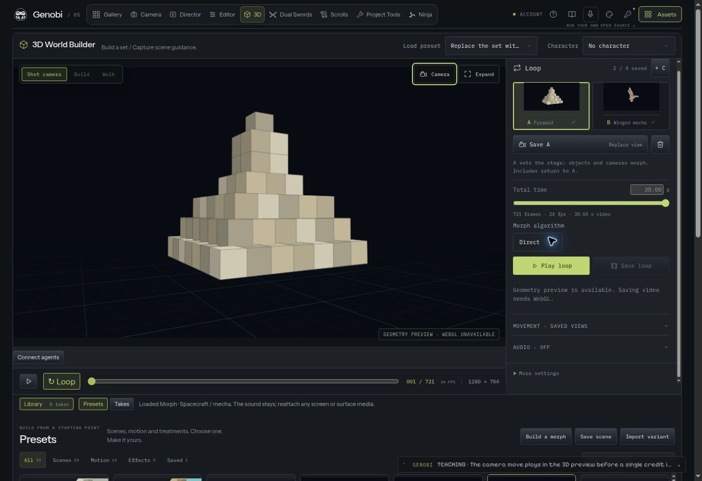

# Build a loop from saved views

The **Loop** panel is the main composition surface beside the 3D view. Assets
and the preset catalogue stay below the view. Camera and music settings open in
the same sidebar; the scene does not acquire another row of per-object A/B
buttons or a large music-response block.

## The short workflow

1. Load an ordinary scene or motion preset. Scrub to the shape you want.
2. In **Shot camera**, drag to orbit, right-drag or Shift-drag to pan, and scroll
   to zoom. **Camera**, beside **Expand**, opens the existing shot, angle, lens
   and movement controls. Build mode is only needed to edit objects.
3. Choose **Save A**. The slot keeps the scene arrangement and its exact camera
   position, look target and lens. The empty B slot becomes the next destination.
4. Load another asset or preset, arrange its view and choose **Save B**. Loading
   it leaves A intact. Click a filled letter to recall that saved view; clicking
   an empty letter only chooses where the next save goes.
5. Set total loop time and the morph algorithm, then choose **Play loop**.
   Two slots travel **A → B → A**. Additional C/D slots extend that sequence and
   still return to A within the chosen total time.
6. Choose **Save loop** to capture the entire fixed-frame take into
   **Library → Takes**. The take retains its recipe, colour/depth guides and
   attached control audio. Its card can reload the recipe, download the video,
   or add/send it to the current project.

The independent slot bank persists in browser storage when available. If storage
is blocked, controls report that the draft lasts only for the current tab.
The soundtrack is kept once as the active scene input, not copied into every
saved letter. A completed take retains the audio and recipe used at capture.

The screenshot uses the labelled geometry fallback. The same loop contracts
are also checked in the WebGL renderer and the real capture path below.

## One place for movement and music

The default camera interpolates between the saved views. The closed **Movement**
controls let a whole-loop camera move take precedence, using the same camera
vocabulary as the existing editor. Selecting a named orbit or shot in Camera
can apply it to the whole loop; choose saved views again to restore the paired
camera path. Object rotation remains an independent X/Y/Z control.

The closed **Audio** controls assign measured bands to the saved letters. Bass
can pull toward A, Mid toward B, High toward C and Sub toward D. The timed loop
continues underneath these pulls. Silence or zero strength preserves its
authored path. These are frequency-energy signals, not a kick/snare classifier.

**Music controls** opens the existing Sound panel, with the soundtrack player,
file input, character-clip routes and a folded **Synth / line input** recorder.
Live input needs HTTPS or localhost. Its continuous object/camera response can
be recorded and analyzed for deterministic playback; character onset triggers
use the prepared recording. See [scene motion](world-builder-motion.md) for
the signal and clip contracts.

## What a slot can contain

A saved slot is a validated geometry/camera snapshot, independent of the active
recipe. Recalling it restores its own definitions, so loading a new preset with
the same-looking object IDs cannot overwrite the saved object or colour data.

The first saved slot sets the loop's shared background, floor, lighting and
backdrop. The saved objects and cameras move within that stage; another slot's
environment is retained for recall rather than switched during the loop.

| Geometry                       | Composition behavior                                                                                |
| ------------------------------ | --------------------------------------------------------------------------------------------------- |
| Compatible retained primitives | Interpolate transforms and saved colours                                                            |
| Different ordinary primitives  | Retain a bounded union and shrink/grow absent parts; their exact zero-presence endpoints are hidden |
| Authored voxel forms           | Split and match boxes deterministically to a common bounded count, preserving endpoint colours      |
| One shared character model     | Retain the model and existing clip sequence; interpolate saved placements                           |
| One acoustic enclosure         | Retain the shell and interpolate its permitted dimensions and source/listener positions             |

The recipe keeps the existing limits: 24 ordinary primitives, at most 256 voxel
parts and 64 KB of saved data, including the prepared soundtrack allowance.
An unsupported or oversized combination explains what must change before
composition. It does not silently remove a saved slot or lower its requested
detail. Different shader worlds, incompatible Playground layouts, attached
textures and different character rigs require a separate reconstruction or
rendering workflow. Image-to-3D and articulated vehicle-to-mecha reconstruction
remain [backlog work](animations-effects-plan.md).

The optional **Build a morph** tool remains in the catalogue for choosing two to
four individual authored forms at a specific density. It has its own draft
preview and explicit Load action; it is not required for the global A/B flow.
The advanced **Scene** panel still edits the underlying authored key sequence.

## Exact duration and LTX handoff

The fader snaps to the local 24 fps `8k + 1` frame grid and accepts a requested
duration through 30 seconds. The readout shows the actual frame count and
encoded duration. For 30 seconds:

| Field            | Value                       |
| ---------------- | --------------------------- |
| Frame indices    | 0–720                       |
| Number of frames | 721                         |
| Frame rate       | 24 fps                      |
| Last sample time | 30 seconds                  |
| Encoded duration | 721/24 = 30.041666… seconds |

The capture manifest includes `ltxTiming.numFrames`, `frameRate`,
`temporalMultiple: 8`, `temporalOffset: 1` and `lastSampleSeconds`. Colour and
depth use the same frame grid. The [LTX-2.5 model card](https://huggingface.co/Lightricks/LTX-2.5/blob/main/README.md)
requires `num_frames % 8 == 1`; this local guide compatibility does not increase
a hosted endpoint's supported duration or remove native decode-memory limits.
See [capture and hand-off](world-builder-capture.md).

Changing the take length after composing a loop retimes its unchanged scene,
camera and character paths together, preserving the return to A. Explicitly
edited character keys retain their timing. A character path that already extends
beyond the take remains a cropped longer move.

## Camera and capture ownership

A Shot gesture commits one authored camera update when it ends. Existing camera
key interpolation, orbit and audio offsets are accounted for when recovering
that authored pose. Direct scrubbing and captures replay it from the recipe.
Manually dragging a named analytic camera move replaces that move with the
exact fixed view.
Playback, loading and capture own independent edit locks; a pending gesture is
cancelled rather than drawing over a captured colour/depth frame.

The lightweight geometry fallback supports this camera manipulation and the
same saved-view workflow, while remaining labelled as a preview. Materials,
characters, Build/Walk and recording still require WebGL. Opening Camera from
the expanded native dialog closes the lightbox first so the sidebar is usable.

## Verification

The repository retains focused loop-bank, saved-view, camera-gesture, modal and
frame-count tests. `scripts/check-world-responsive.mjs` checks the actual phone
layout and catalogue controls. `scripts/check-world-long-take.mjs` records an
actual RGB/depth take and checks its decoded frame counts with ffprobe. Local
rendering is separate from LTX generation; no model inference is needed to
prepare or capture these guides.

`scripts/check-world-scene-loop.mjs` verifies independently saved
Pyramid (64 parts), Banana (96) and Chamber (64) slots, composes a return to A,
and exports 721 RGB/depth frames. The
[31 October capture report](media/world-loop-capture-report.json) records exact
saved cameras, preserved colour volumes, matching forward/reverse frame hashes,
matching return endpoints and decoded 24 fps frame counts. A separate
cube-to-sphere sequence checks that absent parts are hidden and that endpoint
pixels match recalled saved scenes. This technical capture contains no audio.
