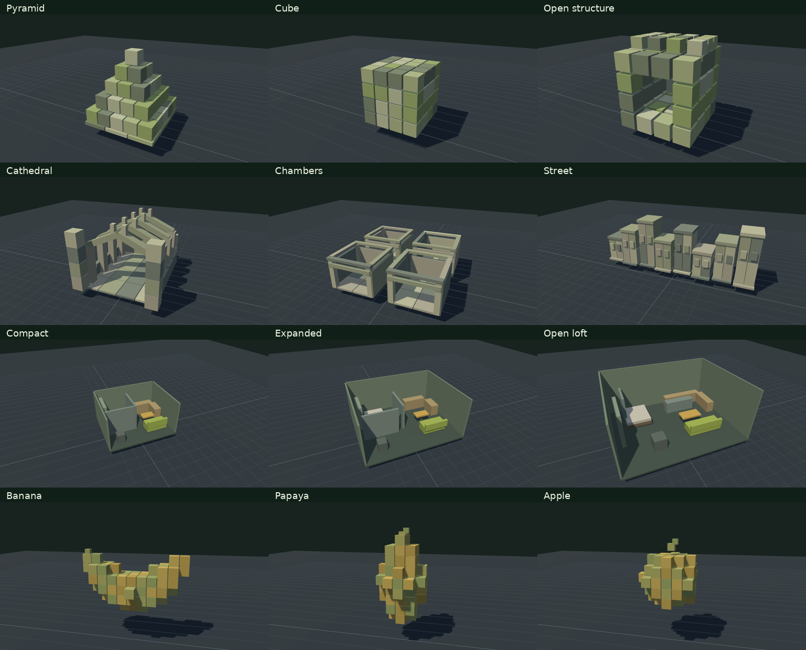
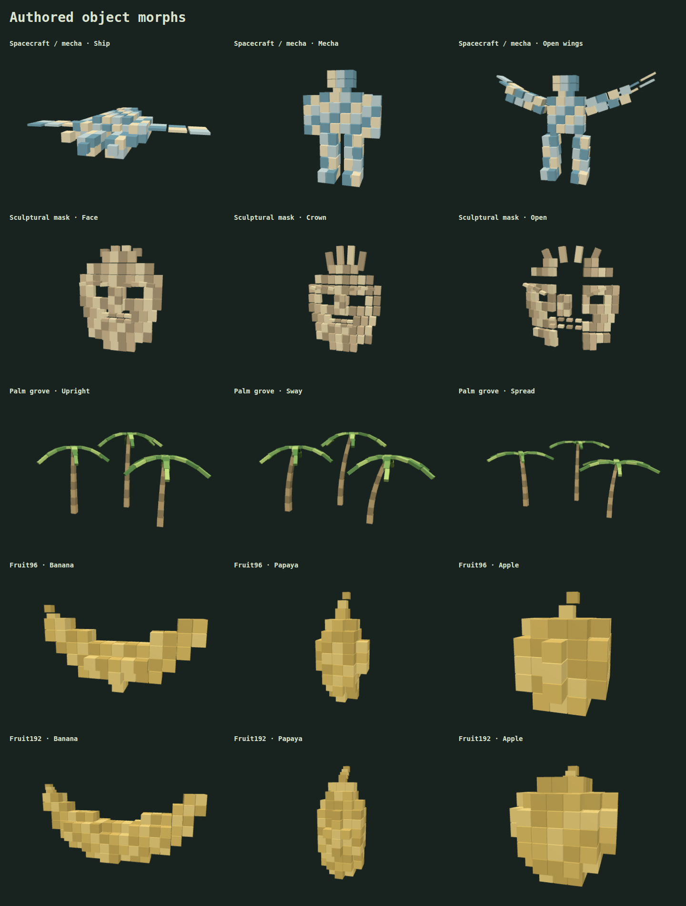
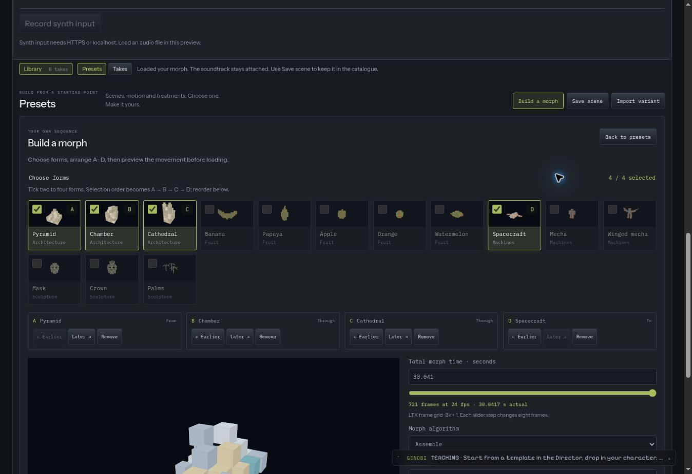
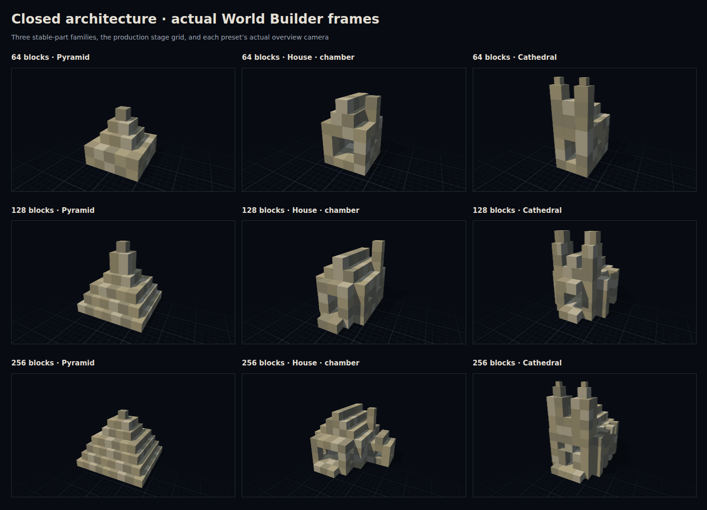

# Scene motion: editable shapes on one timeline

World Builder has an optional scene animation engine inside its existing Three.js
viewer. It runs on the website and in the standalone Comfy scene adapter. Loading,
editing, playing and capturing a scene needs no provider key or inference GPU.
The full viewport uses browser WebGL. Browsers without WebGL get a clearly marked
geometry preview for configuring and scrubbing primitive/camera motion. It uses
box proxies, omits character models, textures and lighting, and cannot capture.

For the main **Save A → Save B → Play loop → Save loop** interface, start with
[the global loop workflow](world-builder-loops.md). This page records the lower
level motion, audio and capture contracts used by that interface.

## Presets inside 3D

Open **3D → Library → Presets**. Filter Scenes, Motion, Effects or Saved, search,
and select a card to preview it. Selection keeps the current scene intact; **Load
scene** applies the configured duration, background and geometry. The same
gallery includes the [editable effects catalogue](effects-catalogue.md).

| Load preset                           | Authored states                               | Geometry                                                              | Acoustic meaning                                        |
| ------------------------------------- | --------------------------------------------- | --------------------------------------------------------------------- | ------------------------------------------------------- |
| Morph · Architecture · 64 / 128 / 256 | Pyramid → House/chamber → Cathedral           | Three densities of enclosed walls, roofs, doors and windows           | Visual enclosure; no acoustic simulation inferred       |
| Morph · Cathedral / street            | Cathedral → Chambers → Street                 | 64 retained cuboids; nave, four chambers, eight buildings             | Explicit single-room proxy, separate from the buildings |
| Morph · Apartment / loft              | Compact → Expanded → Open loft                | 12 furniture and partition objects inside a changing rectangular room | The enclosing room supplies the acoustic dimensions     |
| Morph · Banana / apple                | Banana → Papaya → Apple                       | 96 retained voxels, with fixed material identity                      | No enclosure inferred                                   |
| Morph · Fine fruit                    | Banana → Papaya → Apple                       | 192 smaller voxels; comparable overall volume                         | No enclosure inferred                                   |
| Travel · City / loft                  | Skyline → Street canyon → Open loft           | 96 parts become architecture, floor, beams and furniture              | Visual architecture, no outdoor acoustic simulation     |
| Travel · Neo Tokyo / loft             | Skyline → Street canyon → Open loft           | Original cool night palette and traveling camera                      | No real-city reconstruction                             |
| Morph · Spacecraft / mecha            | Spacecraft → Mecha → Winged mecha             | 128 persistent authored parts                                         | No enclosure inferred                                   |
| Morph · Mask / crown                  | Mask → Crown → Open mask                      | 96 persistent geometric parts                                         | No enclosure inferred                                   |
| Motion · Palm grove                   | Upright → Sway → Spread                       | 96 parts form trunks and moving fronds                                | Sculptural motion, not a vegetation simulation          |
| Morph · Fruit / audio branches        | Banana → Papaya → Apple → Orange → Watermelon | 96 retained parts; separate progress and target controls              | Spectral-band routing; no instrument classification     |

Three-state object studies start with a fixed camera and state keys at frames **0, 72 and
144**: six seconds of movement in a **6.0417-second** take. City journeys use
frames **0, 96 and 192**, with camera position, look target and lens keys on the
same clock: eight seconds of movement in an **8.0417-second** take. This follows
the existing 8k + 1 capture grid. The main Load preset menu and gallery expose
the same recipes as agents. The fruit card offers **96 / 192 voxels** before
loading; doubling cells reduces their side lengths while retaining the volume.
Architecture offers **64 / 128 / 256 blocks**. Increasing that count adds masonry,
roof and facade detail while preserving an enclosed silhouette. The five-state
fruit example has four equally spaced transitions on the same saved clock.

## Choose forms, then choose how they move

**Build a morph** is a separate gallery action. Select two to four forms and
arrange their order. Fourteen authored forms cover pyramid,
chamber, cathedral, banana, papaya, apple, orange, watermelon, spacecraft, mecha,
winged mecha, mask, crown and palms. These are individual geometry states; a motion
preset is a ready-made sequence with timing, camera and response settings.

Choose **64, 128 or 256 retained parts** and a transition style. More detailed
parts split occupied cuboids; coarse reductions merge nearby parts and approximate
the silhouette. Forms are centered on a common floor and comparable scale, then
matched deterministically to persistent IDs. Imported images, arbitrary meshes
and character rigs are outside this authored library.

| Style    | Movement between the selected endpoints                        |
| -------- | -------------------------------------------------------------- |
| Direct   | Interpolates retained parts directly into the next form        |
| Scatter  | Separates blocks along seeded arcs, then brings them together  |
| Twist    | Rotates alternating horizontal layers while changing form      |
| Assemble | Staggers each block through a compact intermediate arrangement |

All styles preserve endpoints and accept direct or reverse seeking. Scatter is
an authored path, not a history-dependent particle simulation; Twist is not a
Rubik's Cube solver. The composer fits a common overview to the forms, transition
excursions and independent target choices. Its saved camera keys start from that
overview and remain editable. After loading, camera, timing, state transforms and audio
remain editable, and **Save scene** keeps the result.

The saved recipe stays within its existing 64 KB bound. The composer reserves
space for a full prepared soundtrack; combinations that exceed it offer fewer
blocks or two forms. All fourteen forms work at 64/128 parts, and the enclosed
architecture sequence supports 256. This does not round the audio or silently
reduce the requested part count.

## Dark stage and enlarged view

Motion presets use a near-black background and **Dark grid** floor. The native
Three.js floor has one-metre cells, stronger five-metre sections and distance
fade, following the visual direction of [Drei's grid](https://drei.docs.pmnd.rs/gizmos/grid).
It does not add React Three Fiber to the application. **Floor** and **Background**
remain independent preset controls; older studio scenes retain their existing look.

Double-click the scene canvas or choose **Expand** to open its lightbox. The
existing canvas, renderer, playback and interaction stay mounted. Play and scrub
inside the enlarged view; **Close** or Escape returns to the gallery and restores
focus. In a browser without WebGL, the same labelled geometry-preview limits apply.

## How to repeat it

1. Open **3D → Library → Presets**, choose an animation and click **Load scene**.
2. In **More settings → Scene → State to edit**, choose an authored state.
   Select a block in Build and use the move/rotate/size gizmo or object inspector.
   Only that state's transform changes.
3. In **Scene motion**, name a state, adjust its frame and outgoing
   easing, or edit voxel twist X/Y, spread, lift and scale. Apartment dimensions
   change its derived walls. Source/listener positions stay inside the room when
   dimensions shrink.
4. Return to **Shot camera** and press Play, or scrub the frame slider. Build
   deliberately hides procedural and audio offsets so they are not baked into
   an authored transform.
5. Use **Loop → Audio → Music controls** to load music or play the example.
   The global Loop panel keeps simple band-to-letter mappings folded away.
   **Scene → Audio → scene** exposes individual targets,
   bands and signed amounts. No loaded track means authored movement only.
6. Save the recipe, or **Library → Presets → Save scene**, to retain
   the states, mappings and camera. Local media must be reattached when loading a
   saved preset, as in existing World Builder scenes.
7. **Save loop**, or use the advanced Capture panel for a fixed-frame take.
   Export RGB, the matching depth video, first frames,
   control-audio WAV when loaded, and the receipt. Changing a scene later cannot
   change the captured recipe.

For another set, **Create three states from this scene** keeps its current
primitives and starts three identical editable positions. Additional states can
be inserted at a scrubbed frame, with the evaluated authored transforms, room and
movement controls retained. The first state stays at frame zero. Changing take
length retimes an otherwise unchanged sequence and retains the selected state.
The stored schema supports **1–16 keys**; the global loop bank offers up to four
saved views plus a return endpoint. Existing longer sequences, including the
five-fruit example, remain editable in the advanced Scene controls.

## Save shapes and cameras as A, B, C and D

Use the global **Loop** sidebar to save complete arrangements and exact camera
views. The independent bank survives regular scene/preset loads: Save A, load a
new set, frame it and Save B. A filled letter recalls its original definitions,
colours and view; an empty letter selects a destination without changing the
scene. Up to four slots compose into a bounded retained-part sequence and a
return to A. Compatible voxel counts are normalized explicitly, while differing
ordinary primitives rebuild through zero-presence endpoints. See
[saved-view compatibility](world-builder-loops.md#what-a-slot-can-contain).

The lower-level `captureSceneState` helper remains available to authors editing
one retained object set. It atomically saves a state and paired camera, supports
replacement in longer legacy sequences, and keeps the shared object identities.
The main UI uses the independent bank instead of repeated save buttons on cards.

Enable **Audio pulls toward states** to assign Bass, Mid, High, Sub or Level to
each letter, or choose Off for a state. The default assignments are distinct and
inactive until enabled. **Pull strength** sets the overall influence. The timed
sequence keeps advancing; current band energy pulls the shape and any linked
camera toward the assigned states. Silence and zero strength leave the timed
baseline. These bands measure frequency energy, not individual drums or
instrument identity.

This simpler route is saved as `motion.stateAudio`. Enabling it disables the
advanced two-axis `motion.morphControl` controller. The advanced controls remain
available for separate progress and target selection; state audio takes
precedence while enabled. Its state references use retained IDs, so renaming a
letter does not disconnect its band.

## Camera travel and bass response

Open **Camera** beside **Expand**, or choose **Shots, angles & lens** under
**Loop → Movement**. City
presets already have an enabled path. **Create camera path** samples the current
shot into three editable keys for another scene. Edit each key's position, look
target, lens, frame and easing. Key edits seek to that key so the result is visible.
Choosing an existing orbit/static shot or editing its legacy lens/movement
controls disables the path; its keys remain available to re-enable later.

Paired A–D saves enable **Camera follows saved states** (`cameraMotion.followMorph`).
During audio pulls and advanced morph control, position, look target and lens use
the same state weights as the object. Each state uses the camera path sampled at
its authored time; paired saves create explicit camera keys there. Ordinary timed
camera travel retains its own keys and easing. Turning the link off keeps the
camera on that independent timeline.

`motion.rotation` rotates the retained scene objects about their saved group
pivot, while `cameraMotion.orbit` rotates the camera about its current look target.
Both select an X, Y or Z axis and up to two signed turns over the take. Zero turns
is neutral. These rotations are evaluated from the saved frame clock, so a reverse
seek produces the same pose and camera; they do not accumulate from playback.

**Camera follows audio** adds a bounded push toward the look target or a vertical
rise. Choose **Sub · 20–80 Hz**, bass, mid, high or whole-track level and an amount
from zero to one metre. Push is additionally capped at 20% of the current camera
distance. Zero and a missing envelope are neutral; target and lens are unchanged.
Audio controls can be tuned during Play independently of scene response intensity.

**Reverse scene & camera** reverses both authored tracks, allowing loft → city as
well as city → loft. An authored character path reverses with them, including its
implicit starting pose. All final keys must lie at the take's end. Character paths
must use linear movement; the action refuses fall easing or a path ending outside
the take, so it cannot silently change the motion. Changing duration retimes
unchanged scene and camera tracks together with character paths inside the take;
imported explicit key times remain subject to validation. Audio continues to follow the soundtrack in its
original direction. Loop repeats the keys; matching the first and final shape,
camera position, target and lens is necessary for a smooth seam.

## What responds to audio

| Mapping                     | Result                                               |
| --------------------------- | ---------------------------------------------------- |
| Morph progress              | A bounded offset along the authored state timeline   |
| Twist X / Twist Y           | Horizontal/vertical lattice-layer rotation; X then Y |
| Spread                      | Changes distances from the group's pivot             |
| Lift / Scale                | Raises or scales the retained voxel group            |
| Room width / height / depth | Changes one explicit acoustic enclosure              |

The presets use independent bands for movement and a small level/sub-to-morph
offset. Twists are Rubik-like layered motion, not a legal Rubik's Cube solver.
Existing per-object audio routes can still address an individual generated
`voxel-000` ID for height, scale, spin or glow. Media textures can be attached to
individual voxel faces through the existing inspector.

Sub is measured separately using cascaded second-order 20 Hz high-pass and 80 Hz
low-pass filters, then per-channel RMS on the 24 fps frame grid. Low, mid and high
retain the existing crossover analysis. Older recipes without sub remain valid
and return silence for sub; reloading audio measures it. These are envelopes, not beat detection,
arbitrary FFT-bin routing or separated snare/hi-hat/bass instruments. Wet room
audio is a separate output and is never analysed back into motion. An independent
soundtrack can be placed in the Editor without changing these controls.

### Trigger a character move from prepared audio

With a character visible, open **Sound → Character moves from audio** and enable
**Audio triggers character moves**. Up to four routes choose a measured band and a clip that the
selected character actually provides. For a local Creature, an unattached FBX
slot stays unavailable until its motion is supplied.

An upward crossing of the trigger level starts the move. **Trigger timing** sets
its speed, active frame count and repeat gap; 24 frames is one second. The latest
accepted crossing takes over, with route order breaking a same-frame tie. After
that window, the character returns to its authored sequence at the current take
time. The original sequence is retained. Missing bands and disabled routes are
neutral.

These routes are saved in optional `Recipe.characterAudio` and evaluated from the
prepared soundtrack, including later frames of a 30-second take. They do not
classify drums or synth notes. While an external input is being recorded, sparse
live metering can move the scene/camera but does not trigger character clips. The
finished recording is analysed offline; playback and capture then share the same
repeatable clip decisions.

## Two independent morph dimensions

Open **Motion controls → Morph routing** and enable **Use morph plane**. The
horizontal dimension chooses progress from an origin; the vertical dimension
blends among ordered targets. Drag the pad or use its labelled slider controls.
The baseline and the audio-adjusted position are shown separately. Disabling the
plane returns to the authored state sequence. State thumbnails always show their
authored form, so target choices remain recognizable while audio is active.

| Control                   | Saved behavior                                                                                 |
| ------------------------- | ---------------------------------------------------------------------------------------------- |
| Origin shape              | A retained state shared by every target path                                                   |
| Progress baseline         | A manual position, or progress through the take timeline                                       |
| Progress audio / response | Adds bounded loudness or selected-band energy to that baseline                                 |
| Target blend              | Manual position among the ordered target states                                                |
| Spectral targets          | Independent enabled band and gain for each destination                                         |
| Target audio mix          | How strongly measured energy moves the target away from its manual baseline                    |
| Blend / Strongest         | Combines energized destinations, or follows the strongest enabled band with a stable tie break |

The fruit branch preset uses banana as origin, with papaya available on the
manual axis. Bass pulls toward apple, mid energy toward orange and high energy
toward watermelon. Loudness controls how far the transformation progresses.
Several bands can produce a weighted mixture. These are measured frequency
bands, so a snare's contribution depends on its spectral energy rather than its
instrument name.

The controller is optional `motion.morphControl` version 1. Its manual baseline
is meaningful without audio; missing signals are silent and zero scene intensity
removes their contribution. With the plane enabled, its progress replaces the
older sequence-offset mapping; twist, spread, lift, scale and the separate camera
response still apply. Changing the origin or removing states reconciles the
target list rather than leaving invalid references. `motion.transitionStyle`
applies to both ordinary state pairs and routed destinations.

## Record a synth or line input

Choose **Music response → Record synth input** in a browser supporting input
recording on HTTPS or localhost. The button asks for microphone/input permission;
the device is the system's default audio input, which can be a synth interface or
virtual loopback. Echo cancellation, noise suppression and automatic gain are
requested off. No device is opened until the button is pressed, and input is not
sent to a server or routed to speakers.

During the bounded take, real-time level/sub/low/mid/high measurements drive the
scene and camera. Input owns the viewport while recording; edits and capture are
held until it stops. **Stop and use recording** ends early, the take duration ends
it automatically, and **Cancel input** discards it and releases the device. A
hidden page ends the take. Closing the scene cleans up pending permission requests,
tracks and audio contexts; expanding the lightbox keeps the same scene mounted.

The dry audio recording is then decoded by the normal offline analysis and
attached as **Synth input**. This recorded soundtrack supplies repeatable seeking
and subsequent RGB/depth capture. Live metering uses short rolling windows and
is not a promise of sample-identical timing to the prepared recording. The
button records audio; **Capture take** creates the rendered visual take afterward.
Recording is bounded by the current take length and 32 MB. The cloud HTTP side
preview cannot request audio input and displays a file-loading alternative.

## Determinism and bounds

`Recipe.motion` is optional and versioned. Old recipes keep their existing
primitive, camera and audio behavior. A pure `evaluateScene(recipe, frame)`
function returns fresh geometry, room, controls and the remaining light/avatar
modulation at any frame. The runtime uses its transforms directly for Shot and
RGB/depth capture. There is no frame-history accumulator.

State interpolation runs before bounded procedural and audio offsets. State
transforms retain the same IDs and topology; material identity remains on each
object. The seeded voxel generator has its own **256-instance cap**, separate
from the existing **24 authored primitives**, plus up to six derived room faces.
The recipe remains limited to 64 KB. There are no arbitrary generators, scripts,
instance birth/death, mesh deformation or imported city maps.

A room records metric dimensions, floor-center position, source/listener local
coordinates, six surface-absorption values, wall thickness and an IR seed. The
apartment's cutaway hides its south wall and ceiling in the guide, while its
acoustic enclosure remains closed. Cathedral chambers and street geometry do not
claim multi-room coupling or outdoor acoustic simulation.

`Recipe.cameraMotion` is optional and versioned, with 1–16 ordered position,
look-target and lens keys plus a separate audio response. The runtime, geometry
preview and guide capture evaluate the same saved camera clock. Existing recipes
without this field retain their original camera behavior. Image-to-voxel
reconstruction, imported mesh correspondence and automatically articulated
transformer rigs remain future work; the current examples are authored shapes.

## Thirty-second local takes and the LTX frame grid

The local duration controls accept up to **721 frames at 24 fps** on the existing
`8k + 1` grid. Entering **30 seconds** gives 721 frames: the last sample is frame
720 at exactly 30 seconds, and the encoded clip lasts `721 / 24`, approximately
30.0417 seconds. Scene and camera keys retime together when their duration changes.
This is the local guide format; it does not extend a hosted model's offered
durations or the fixed combined deployment endpoint.

Prepared level, sub, low, mid and high envelopes can each hold 721 samples. Analyses
of 241 samples or fewer keep their prior precision. Longer prepared envelopes
round to four decimal places, with at most 0.00005 change per normalized sample.
The same prepared arrays drive preview, saved recipes and capture. The **64 KB
recipe limit remains**; combinations that do not fit ask for fewer blocks, fewer
states or a shorter take instead of silently discarding geometry or sound.

Fixed capture receipts retain `frameCount` and `duration` and add `ltxTiming` with
`numFrames`, `frameRate`, `temporalMultiple: 8`, `temporalOffset: 1` and
`lastSampleSeconds`. RGB and depth share that exact sample grid; the WAV companion
is trimmed or padded to the complete encoded duration.

The native Comfy capture node accepts the same 721-frame bound and keeps its
separate **2 GiB decoded RGB check**. A 512 × 320, 721-frame guide passes that check;
1024 × 576 at 721 frames exceeds it and is refused. Reduce the guide dimensions
or split the take when that native-memory bound applies. Browser capture keeps
the existing 128 MB limit per encoded video stream.

## Capture and workflow boundary

Motion receipts add `sceneEvaluation`: evaluator/analysis versions, canonical
recipe and control-envelope hashes, exact first-frame geometry/camera identity,
state IDs and the acoustic room identity. Existing RGB/depth/first-frame hashes
remain. A loaded WAV companion is explicitly labeled `motion-control` and its
hash is bound to that receipt.

This records local guide evidence; it does not complete the broader project-wide
asset-swap invalidation contract. Depth is an aligned exported guide. It is not
automatically wired as LTX conditioning. Canny export is outside this change.

The current combined Layout-to-video deployment graph uses native **static**
acoustic nodes. Animated recipes are refused before deployment submission and by
those native nodes, so they cannot silently become a static room or open sky.
Use the exported guides for a custom motion experiment, with a separately
rendered sound track. LTX motion adherence, image-conditioned fruit transitions,
native dynamic acoustic-node support and generated-video quality still require
their own workflow implementation/qualification.

### What an image can do today

The object inspector can attach an image or video to a primitive's surface. This
changes its appearance; it does not infer a block structure or hidden 3D shape.
**Send first frame** puts the rendered scene image into the project's Inspirations.
Captured MP4/WAV assets and the scene recipe can also be retained in the project.

For a compatible static Layout-to-video deployment, the captured first frame is
initially assigned to `REFERENCE_PNG`. The deployment input panel lets the person
replace it with their own image as a look reference. This can reuse an original
image manually, but the current handoff does not automatically track an original
image through a future image-to-block conversion. The graph expects a look image
at the take's first camera angle; a reference does not guarantee exact motion
adherence. The simpler first-frame image-to-video handoff does not enforce a 3D
camera path either.

## Agent entry points

Use `genobi_world` to list `presets`, then `load-preset` with one of these IDs:
`voxel-architecture`, `cathedral-street`, `apartment-morph`, `fruit-morph`,
`fruit-morph-fine`, `city-to-loft`, `neo-tokyo-to-loft`, `spacecraft-mecha`,
`mask-morph`, `palm-grove`, `voxel-architecture-128`, `voxel-architecture-256`,
`fruit-audio-branches`.
The returned recipe includes the motion schema. Read `recipe` for its current
revision, edit state transforms/mappings, and use the existing guarded
`genobi_world_recipe` handoff. The CLI exposes the same tools. Capture uses the
existing `capture` command and returns the same artifact set as the UI.

In a mounted browser, `window.directorScene` offers `loadPreset`, `getRecipe`,
`configure`, `render` and `capture`. A direct recipe import must carry valid,
ordered frame keys; automatic retiming only applies when changing the duration
of an otherwise unchanged sequence.

## Next: images into reusable voxel assets

The composer already normalizes and matches the fourteen authored forms. A future
image/mesh importer should
first produce a bounded, versioned voxel asset with source provenance, a common
scale/origin and a preview for approval. Its correspondence step can then feed
two to four such assets into ordinary retained-part scene keys. This
keeps reconstruction, part matching, camera choreography and audio routing
independently editable. The current application does not infer hidden 3D shape
from one image or reconstruct a transformer rig automatically. Retain the original
image's asset identity alongside the reviewed block asset, then explicitly reuse
that image in a compatible video's reference input. Automatic reconstruction and
that provenance-preserving image handoff remain additional work.

## Local verification

Focused tests cover old-scene parity, one/two/three/four/five-state forward and reverse
seeking, fixed instance identities, transform order, bounded audio, room geometry,
state-local edits, duration changes and capture fingerprints. Browser checks
cover the actual viewport, instance editing, textures, saved recipes, narrow
layouts and RGB/depth evidence. `scripts/check-world-scene-motion.mjs` runs against
a local Vite server and blocks provider/network writes. The standalone adapter
must also be rebuilt and checked with the existing scene-adapter commands.

`scripts/check-world-long-take.mjs` also exports a real 721-frame, 384 × 256
RGB/depth pair in Chromium, with state audio and a complete camera orbit. The
31 October 2026 run passed: both files decoded to 721 frames at 24 fps and
30.041666 seconds; preview, capture, reverse seek and RGB restoration agreed
pixel-for-pixel, and depth reseeking agreed. The manifest reports frame 720 at
30 seconds. The rendered recipe used 36,106 bytes, below the unchanged 64 KB cap.
[View the silent 30-second RGB guide](media/world-morph-30s.mp4).

Related: [World Builder](world-builder.md), [sound controls](world-builder-sound.md),
[changing room sound](world-builder-dynamic-sound.md),
[capture](world-builder-capture.md), [GPU evaluation](audiovisual-gpu-evaluation.md).

