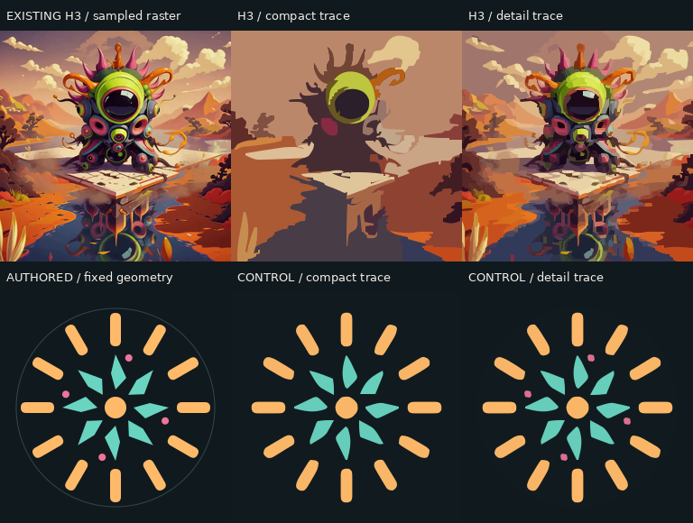

# Video to vector: bounded local study

**Frame tracing produces real SVG paths, but does not by itself produce a
smooth, editable animation with persistent shapes.** This study exports both
an independently traced H3 flipbook and a continuous SVG geometric control.
It does not generate new MiniMax footage, access Drive, or reconstruct the
creature as a parametric rig. No provider, model or paid API is called.

## Look at the result

- [Comparison video](previews/comparison.mp4): 2 seconds, 768 × 580, 12 fps,
  silent. Top: existing H3 footage, compact trace, detail trace. Bottom:
  authored geometric control, compact trace, detail trace.
- [Continuous kinetic SVG](previews/kinetic-control.svg): authored geometry;
  open in a browser to see continuous rotation. It contains 27 persistent
  paths, three animated transform groups, and no raster image.
- [Traced H3 SVG flipbook](previews/h3-traced-flipbook.svg): actual vector paths
  in 24 frame groups, switched discretely at 12 fps. Open in a browser to play.
  This is a **frame sequence**, not a smooth path morph or recovered object rig.
- [Detailed H3 first frame](previews/h3_detail-first-frame.svg) and
  [compact first frame](previews/h3_trace-first-frame.svg): static vector output.
- [Raw measurements and every frame](previews/metrics.json).



## Inputs and provenance

The existing source is
`public/media/director-templates/dimensions-mix/mix-02.mp4`, a 720 × 720,
24 fps, 13.5-second bundled clip. Only seconds **1–3** are sampled: 24 frames
at 12 fps, resized to 256 × 256. This is the owner's existing MiniMax H3
open-weights output, documented in [Dimensions mix](../../docs/dimensions-mix.md#the-slices)
and [the media licence inventory](../../LICENCES.md). It was made outside
this experiment; the original prompt is not recovered or inferred here.
The file's SHA-256 is recorded in `metrics.json`.

The geometric control is created directly by `kinetic_svg()` in `run.py`:
fixed path IDs, fixed path commands and analytic rotation of three groups.
Its raster frames are then traced independently with the same settings as
H3. It supplies known geometry against which the tracing behavior can be
examined. It is not an automatic reconstruction of the H3 clip or a Drive
reference.

The source and its derived H3 previews retain the existing owner-supplied
media conditions; they are not relicensed as MIT. The authored control and
experiment code are new repository work. No third-party tracing code or
model weights are vendored.

## What was measured

VTracer 0.6.12 fits colored raster regions to SVG spline paths. The compact
preset uses 4 bits per channel, layer difference 48 and speckle filter 16.
The detail preset uses 6 bits, layer difference 16 and speckle filter 4.
All settings and dependency versions are in `metrics.json`.

| Case, 24 sampled frames | Paths per frame | Adjacent command-layout changes | Independent SVG bytes, all frames | RGB absolute error, mean / 255 | Adjacent residual change / 255 |
| ----------------------- | --------------: | ------------------------------: | --------------------------------: | -----------------------------: | -----------------------------: |
| H3, compact             |           29–47 |                         23 / 23 |                         1,400,772 |                         26.956 |                         15.272 |
| H3, detail              |         796–852 |                         23 / 23 |                         8,125,635 |                         13.516 |                         10.539 |
| Control, compact        |              22 |                         23 / 23 |                           240,864 |                          3.905 |                          5.698 |
| Control, detail         |              27 |                         23 / 23 |                           285,844 |                          3.427 |                          4.929 |

The authored control itself is **3,809 bytes**, with 27 paths and 153 path
commands. Its IDs and geometry stay fixed while transforms change. The
compact H3 flipbook, including timing markup, is **1,440,422 bytes**. The
comparison MP4 is **403,540 bytes**. The larger detail frame sequence is
measured in temporary storage; only its first SVG and its rendered comparison
are retained.

These measurements need careful interpretation:

- **Path-count changes** are a structural-instability proxy. Compact H3 changes
  by an average of 5 paths between samples; detail H3 changes by 14. These
  counts do not identify object births, holes or perceptual flicker.
- **Command-layout change** compares the ordered command-type sequences in
  each frame's paths. Every adjacent pair differs, even when the control has
  a constant path count. Directly interpolating the exported paths in their
  current order therefore has no compatible command layout. Reordering,
  resampling and tracking could produce a different result; this study does
  not implement those operations. Equal layouts alone would not prove object
  correspondence either.
- **RGB error** compares the rasterized SVG to the corresponding sampled
  input. The compact setting visibly drops details and small control features;
  the detail setting preserves more at a much higher path and byte count.
- **Adjacent residual change** is `mean(abs(e[t] - e[t-1]))`, where
  `e[t] = rendered_trace[t] - input[t]` in RGB levels. It includes moving-edge
  and rasterization error and is **not motion-compensated flicker** or a
  perceptual smoothness score. It cannot separate genuine source changes
  from tracing instability.

The authored control is a demonstration of a different representation,
not a fair compression benchmark against the richer creature scene. Its
continuous browser animation also differs from the 12 fps diagnostic movie.
This is one excerpt, one control and two tracing settings, not a general
benchmark or proof that all video vectorization fails.

## Practical direction for kinetic art

For clean geometric kinetic work, use generated video as a motion reference,
then build or fit a small model with persistent primitives: repeated bars,
petals, circles, curves, masks and a limited palette. Preserve shape IDs and
path topology; express movement as translation, rotation, scale and a small
set of continuous parameters. The control demonstrates that final
representation. It does **not** yet infer those parameters from video.

A reference-driven prototype should next pick one actual reference, identify
its primitives and occlusions, fit trajectories over time, review the fit,
and export continuous SVG transforms or compatible path keyframes. Texture,
lighting, particles and changing silhouettes may need deliberate stylization,
manual reconstruction or a raster layer. The latter must remain labelled as
raster rather than being hidden inside an allegedly vector-only SVG.

Why this distinction is grounded in the formats and algorithms:

1. [VTracer's official repository](https://github.com/visioncortex/vtracer)
   describes raster-image tracing and color-region fitting. Independent use
   on each frame does not establish persistent object identities.
2. [SVG 2 path interpolation](https://www.w3.org/TR/SVG/paths.html#TheDProperty)
   requires matching numbers, types and ordering of path commands for smooth
   `d` interpolation. [SVG animation](https://www.w3.org/TR/SVG11/animate.html#AnimateTransformElement)
   also supports transform animation of existing geometry, as used here.
3. [Tutrace, Loïc Vital, GRAPP 2025](https://www.scitepress.org/Link.aspx?doi=10.5220%2F0013097900003912)
   treats video vectorization as a separate correspondence problem: it starts
   from binary frame traces, establishes vertex correspondences and extracts
   an editable animated shape. Its binary-input scope is narrower than this
   full-color H3 example; that method was not implemented or evaluated here.

## Repeat locally

Requires Python 3.12, FFmpeg/ffprobe and Cairo's shared library. The recorded
run used FFmpeg 6.1.1. Install only this experiment's pinned Python dependencies
in a temporary environment; no app dependency or lockfile changes are needed.

```sh
python3 -m venv /tmp/genobi-vector-study
/tmp/genobi-vector-study/bin/pip install -r experiments/vector-study/requirements.txt
/tmp/genobi-vector-study/bin/python experiments/vector-study/run.py
```

Use `--out /tmp/vector-study-results` to keep a repeat run outside the tree.
The script reads the bundled source, creates the control, traces both presets,
rasterizes the SVGs for comparison, writes the previews and metrics, and
removes its temporary frame files. It rejects raster/HTML embeddings in the
SVGs, checks that 24 source frames were produced and caps the flipbook at 2 MB.
The displayed movie labels use DejaVu Sans when available and fall back to
Pillow's font; that can alter MP4 bytes without changing tracing metrics.

Local verification on 31 October 2026: the script completed; every output SVG
parsed and contained paths with no `<image>`, `foreignObject` or raster data
URI; ffprobe confirmed 24 frames, 12 fps, 2 seconds. Chrome 148 confirmed that
the control's path IDs/data stay identical while transforms change, and that
the flipbook shows exactly frames 0, 1, 23 and 0 at 0.02, 0.11, 1.99 and
2.02 seconds. The six-panel image was visually inspected. No claim is made
about physical display frame pacing or universal SVG-player support.
